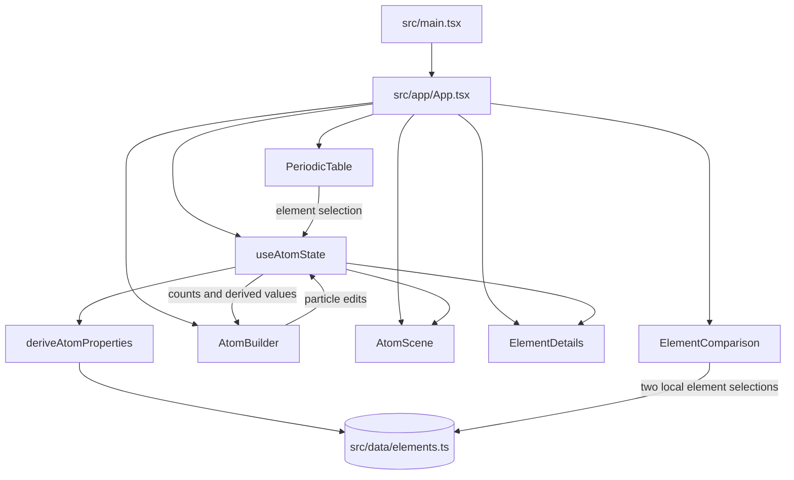

# Architecture

This document describes the current source tree and runtime data flow. It does not describe proposed orbital or nuclear-physics features as implemented.

## Application structure

`src/main.tsx` imports global styles, verifies the root element exists, and mounts `App` under React Strict Mode. `src/app/App.tsx` composes the header and navigation, selects among Simulator, Periodic Table, and Scientific Principles views, and opens the information dialog. Reusable panels, icon buttons, loading UI, and layout primitives live in `src/components/`. Feature-specific components and styles are organized under `src/features/`.

The root `App` creates one `useAtomState` instance. It is the shared source for particle counts, visualization mode, selected element identity, and derived atom properties. Individual visual controls such as play state, path visibility, and 3D reset are local to `AtomScene`; the two element selectors are local to `ElementComparison`.

## Periodic table and element data

`src/data/elements.ts` exports the bundled element collection and lookup maps. Each `ElementData` record includes identity/classification, electron configuration and shell counts, selected physical properties, discovery fields, and common isotope records. `src/data/element-categories.ts` provides category names and colors. These are local static data; there is no runtime data API.

`PeriodicTable` places records in an 18-column CSS grid, with lanthanides and actinides rendered in separate rows. Search, category filtering, temperature display, and the selected element are presented by this feature. On narrow layouts the table retains its readable tile size and scrolls horizontally. Selection is sent to the shared atom-state hook.

The temperature control presents a state estimate at 1 atm from stored melting and boiling points when both exist. Missing transition points fall back to the record's standard state or unknown; the display is not a phase-equilibrium calculation.

## Shared atom state and calculations

`src/hooks/useAtomState.ts` stores `{ protons, neutrons, electrons }` and visualization mode in React state. It clamps interactive counts to its supported ranges. `selectedElementNumber` is derived from proton count, avoiding a separate element-selection state that could disagree with the particle builder. `derived` is memoized from the current counts.

Selecting an element sets proton count to its atomic number, chooses the first listed common isotope's neutron count (or uses the atomic number as a fallback), and sets electrons equal to protons. “Make Neutral” changes only the electron count to match protons. These are UI defaults and do not establish that the chosen isotope is the most abundant isotope for every record.

`deriveAtomProperties` combines count calculations, dataset lookup, shell distribution, valence-shell count, ion formatting, and isotope assessment. Scientific utility code is separate from React presentation so it can be unit tested directly.

## Chemistry utilities

- `src/lib/chemistry/atomic-properties.ts` calculates integer mass number (`protons + neutrons`), looks up the element, derives display properties, and assesses isotope status using listed common isotopes followed by fallback heuristics.
- `src/lib/chemistry/ion-charge.ts` calculates proton-minus-electron charge, classifies neutral/cation/anion state, and formats charge/symbol text.
- `src/lib/chemistry/electron-configuration.ts` maps a neutral element's provided shell data into display use, calculates simplified shell distributions for changed electron counts, exposes a fallback Aufbau shell filling order, and formats configuration exponents. The displayed neutral subshell string itself comes from the element record.
- `src/lib/utils.ts` holds generic helpers such as clamping, class merging, and number formatting.

These routines are introductory models. In particular, shell redistribution for ions is not a full orbital-removal model, and the isotope fallback is not a complete nuclide database.

## Atom visualization

`AtomScene` renders the Bohr-style SVG through `ElectronOrbit` and `Nucleus`. The view exposes animation and shell-label controls; `useReducedMotionPreference` initializes animation appropriately and stops it when reduced motion is requested.

The `nucleus-3d` mode lazy-loads `ThreeNucleus.tsx`, which uses React Three Fiber, Three.js instanced meshes, and Drei orbit controls to show a rotatable particle illustration. It supports path and particle visibility plus reset controls. A fallback message is rendered when loading or WebGL rendering fails. The Three.js module is split from the initial app bundle.

The `orbital` mode is an explanatory placeholder, not a working orbital visualization. The `3D Nucleon Physics` option is also a placeholder. Neither should be documented or demonstrated as an implemented simulation.

## Element details and comparison

`ElementDetails` combines current nuclide-derived information with the selected element's bundled record. `ElementProperties` groups identity, configuration, physical properties, and discovery information. Neutral configuration and shell values are explicitly identified as dataset values; null property values are rendered as unavailable.

`ElementComparison` keeps two selector values locally and renders a semantic table of the selected records' available values. The comparison is element-to-element and uses bundled values; it does not compare custom ion states. Property uncertainty flags are not present in the data schema, so the UI cannot distinguish measured and estimated values per field.

## Styling and accessibility

Global reset and theme tokens are in `src/styles/`. Components and features import their own stylesheets. Layout breakpoints are implemented with CSS grid and media queries. Controls use native buttons, inputs, selects, labels, table semantics, accessible names, and visible focus styles. Reduced-motion styles are applied globally, with the SVG animation additionally controlled by the preference hook.

Automated tests provide source-level verification, not a full accessibility audit. Screen-reader behavior, real WebGL interaction, contrast under actual display conditions, and browser-specific responsive rendering still require manual review.

## Testing strategy

Vitest runs tests in jsdom with setup from `src/test/setup.ts`; React Testing Library exercises rendered interactions. Current tests are organized alongside the data, chemistry utilities, shared-state hook, common components, periodic table, element explorer, visualization controls, and app flow. `npm run test` runs the suite once. There is no browser automation suite configured in `package.json`.

Use `npm run typecheck`, `npm run lint`, `npm run test`, and `npm run build` for local verification. The production build also performs TypeScript checking before Vite bundles the app.

## Related documents

- [Scientific model and limitations](SCIENTIFIC_MODEL.md)
- [Implementation plan and pending manual checks](IMPLEMENTATION_PLAN.md)
- [Portfolio summary](PORTFOLIO.md)
- [Manual screenshot checklist](SCREENSHOTS.md)
